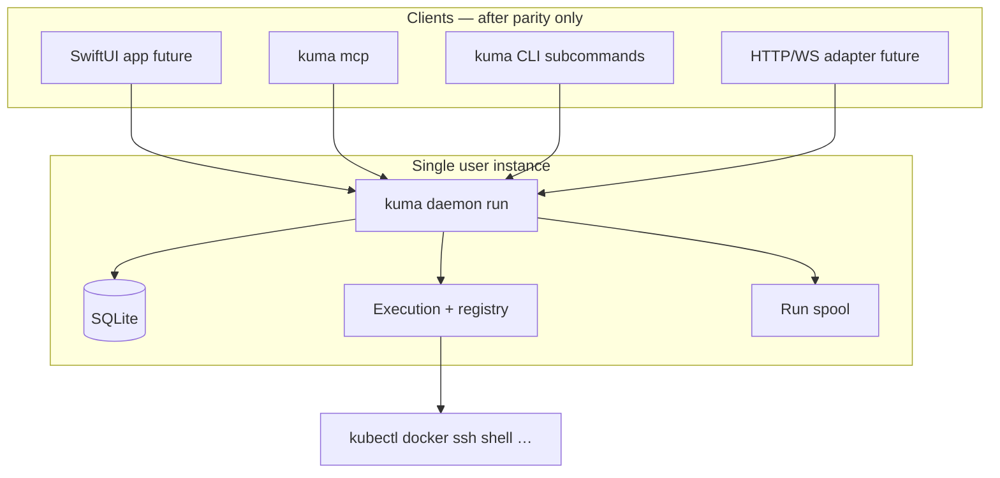

# Feature Spec 07: Kuma Daemon (V2 Core, Rust)

> **Status:** In progress — Rust scaffold in `daemon/`; **detailed contract complete** in [`docs/specs/daemon/`](daemon/00-overview-and-conventions.md) (00–15)  
> **Target:** Kuma 2.x daemon + CLI; macOS first (Linux/headless later if needed)  
> **Implementation root:** `daemon/` (Rust workspace)  
> **App 1.x:** Unchanged until daemon reaches parity (see §5, [15](daemon/15-appendix-file-coverage.md))  
> **Related docs:** [`daemon/00-overview-and-conventions.md`](daemon/00-overview-and-conventions.md) (FEAT / DEV / DT IDs, RPC registry); 1.x behavior refs `03-workspace.md`, `06-services.md`, `05-data-port.md`; Rust learning `referensi-rust-kuma.md`

---

## 1. Purpose

Ship a **standalone Kuma daemon** that is the **only owner** of:

- SQLite workspace/service database (compatible migration story with 1.x — TBD in implementation)
- `ServiceExecutionEngine` equivalent (all runners, supervisor, process registry)
- Run log spool and live log broadcast
- Secrets vault: `master.key` + AES-256-GCM (1.x CryptoVault wire format; **DEV-09** — not Keychain; see [02](daemon/02-security-and-secrets.md)) and LaunchAgent lifecycle

All frontends — SwiftUI app (future), **`kuma mcp`**, CLI, web adapter (future) — are **clients** of the daemon. They never spawn dev processes directly.

This spec does **not** authorize edits to `Kuma/` Swift sources during daemon development.

---

## 2. Naming (locked)

| Item | Name |
|------|------|
| User-facing CLI binary | `kuma` |
| Long-running server | `kuma daemon run` |
| LaunchAgent install | `kuma daemon install` / `kuma daemon uninstall` |
| MCP stdio proxy | `kuma mcp` |
| Avoid | `kumad` (deprecated shorthand in older notes) |

Internal Rust crate names may use `kuma-daemon`, `kuma-protocol`, etc.; the only required user-visible binary name is **`kuma`**.

Optional later: symlink `kuma-daemon` → `kuma` for plist brevity; not required for v1 CLI.

---

## 3. Repository layout

```text
daemon/
  Cargo.toml              # workspace
  crates/
    kuma-protocol/        # JSON DTOs + RPC method names (serde)
    kuma-core/            # domain, per-service state machine, invariants
    kuma-store/           # SQLite persistence
    kuma-exec/            # supervisor, runners, spool, child processes
    kuma-daemon/          # Unix socket server, session wiring, shutdown
  kuma/                   # clap binary: subcommands daemon | mcp | …
docs/
  specs/07-kuma-daemon.md     # this overview
  specs/daemon/00-15*.md      # normative daemon contract (FEAT/DEV/DT)
  …                           # 1.x specs remain behavioral baseline
```

Documentation for V2 lives under **`docs/`** (not only inside `daemon/`). Implementation notes may link from `daemon/README.md` to this spec.

CI: separate workflow scoped to `daemon/**` so Xcode CI for 1.x stays independent.

---

## 4. Architecture

### 4.1 Process model



### 4.2 Transport

- **Unix domain socket** on localhost (path under user config dir — exact path defined at implementation time).
- **JSON-RPC 2.0** over the socket (newline-framed or length-prefixed — pick one in `kuma-protocol` and document).
- Rationale: language-agnostic, easy to debug with `nc`/CLI; matches architecture notes for non-Swift daemon. gRPC may be added later; not required for first parity.

### 4.3 Multi-client rules (from architecture review)

1. **Serialized commands** in the daemon. Concurrent `start` for the same service → second caller gets idempotent result (“already running”), not a duplicate process.
2. **Broadcast events** for state and log lines; new subscribers get **spool replay** then live stream.
3. **Optimistic concurrency** on config writes: requests carry a version; stale writes are rejected.

### 4.4 Single instance

One daemon per user session (same intent as `SingleInstanceGuard` in 1.x), enforced in the daemon process (bind socket / pid file / both).

### 4.5 Lifecycle

- **`RunSpool.purgeAll()`** (1.x runs at app launch): moves to **daemon startup** with rules that do **not** delete spool for services still running (mirror `docs/specs/00-app.md` invariants).
- UI exit does not stop services; daemon exit/restart follows supervisor adoption rules from `06-services.md`.

---

## 5. Parity scope (“complete” gate)

The **parity gate** is defined in [daemon/00 §1](daemon/00-overview-and-conventions.md): every `[PARITY]` **FEAT-***, invariants **INV-D-***, and acceptance **DT-*** in 00–15. This overview maps legacy 1.x docs; implement from the daemon folder.

The daemon is **complete** when that gate passes (CLI/integration tests, no Swift app required):

| Area | Reference |
|------|-----------|
| Workspaces, services, groups | `03-workspace.md`, `06-services.md` |
| All runners (K8s, Docker/Podman, shell, SSH, tunnel, health, process monitor) | `06-services.md`, Core runner behavior in 1.x |
| Auto-reconnect (K8s, SSH, shell) | `06-services.md`, `docs/testing/06-services-test-matrix.md` |
| DataPort import/export/backup | `05-data-port.md`, test matrix |
| Encrypted credentials (`master.key`, AES-256-GCM) | [daemon/02](daemon/02-security-and-secrets.md), **DEV-09**; 1.x `CryptoVault.swift` |
| Live logs | Spool + multiplexed subscribers |

**Out of scope until after parity gate:** SwiftUI migration, notarization bundling with `.app`, web adapter.

**In scope after core stable:** `kuma mcp` mapping MCP tools to JSON-RPC (rmcp / stdio).

---

## 6. Development workflow (no 1.x code changes)

1. Implement protocol + `kuma daemon run` + dev CLI commands (list/start/stop/tail).
2. Port runners and persistence incrementally; each milestone checked against spec + test matrix rows.
3. macOS: vault parity (`master.key`, AES-256-GCM per **DEV-09**) + LaunchAgent via `kuma daemon install`.
4. When parity checklist passes → add **`kuma mcp`**.
5. **Then** plan Swift client (new targets or new app) — separate spec; do not refactor 1.x in place without explicit decision.

---

## 7. macOS integration

- **LaunchAgent:** user agent, not bundled XPC inside `.app`.
- **Code signing:** when shipping, sign the **`kuma`** binary (not `kumad`) with the same team as Kuma.app for notarization (integration phase).
- **Secrets:** 32-byte `master.key` in the data dir, AES-256-GCM ciphertext in SQLite — byte-compatible with 1.x CryptoVault (**DEV-09**); no Keychain access group.

---

## 8. Migration & versioning

- **1.x** remains the shipped Swift monolith until maintainers declare cutover.
- **2.0.0** tag semantics: first release where **`kuma` daemon + CLI** (and optionally MCP) meet parity; Swift app migration may be **2.x app release** or separate product — TBD when parity is reached.
- Database: prefer **read/migrate 1.x SQLite** via documented migration in `kuma-store`; details belong in implementation plan, not in this spec’s first draft.

---

## 9. Risks

| Risk | Mitigation |
|------|------------|
| Behavior drift vs 1.x | Specs + test matrices as acceptance; integration tests in `daemon/tests/` |
| Dual maintenance | Time-box 1.x fixes; daemon-only features only after parity unless critical |
| Solo + new language | Learning path in `referensi-rust-kuma.md`; vertical slices per runner |
| PATH confusion `Kuma.app` vs `kuma` | Document install channel (brew, release tarball, embedded in future bundle) |

---

## 10. Open decisions (implementation plan)

- Exact socket path and JSON-RPC framing
- SQLite schema: byte-compatible vs migrate-on-first-open
- Whether `kuma` subcommands for service CRUD ship in parity v1 or only via RPC from a thin CLI

---

## Changelog

| Date | Change |
|------|--------|
| 2026-11-02 | Initial planned spec: `/daemon`, `kuma` CLI, no 1.x edits until parity |
| 2026-11-02 | Link `docs/specs/daemon/` 00–15; parity gate via FEAT/DEV/DT; secrets = `master.key` (DEV-09), not Keychain |
